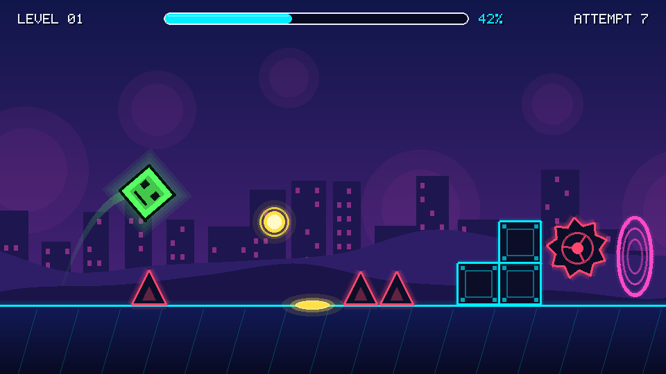
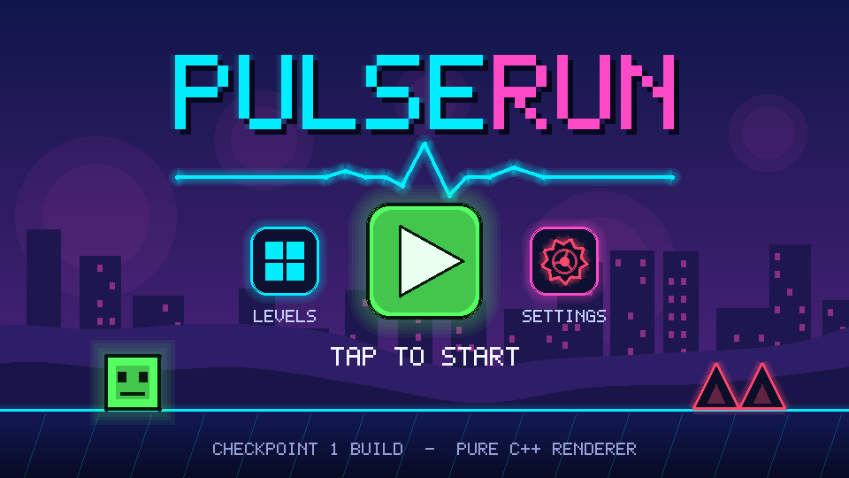
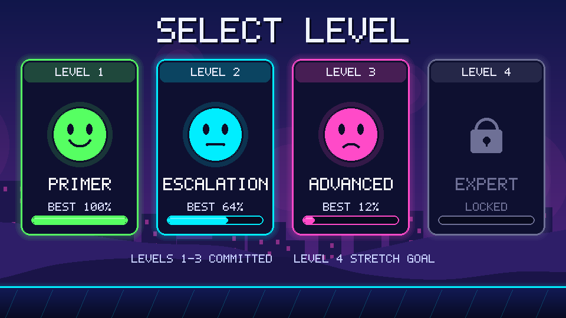
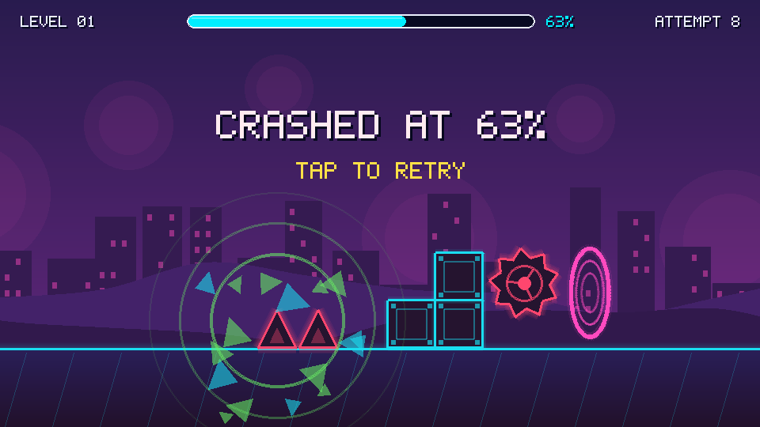

# PulseRun

**A 2D level-based obstacle platformer (Geometry Dash style) whose graphics are built from scratch in C++.**

PulseRun is our Computer Graphics semester project. The goal is not just a game that looks good, but one where every
shape on screen is produced by graphics algorithms we implemented ourselves: lines, circles, polygons, clipping and
curves. This repository is at **Checkpoint 1 (Technical Foundation)**: a pure C++ software renderer plus the first
game-style screens drawn with it.

## Screenshots

| Gameplay | Main menu |
|---|---|
|  |  |
| **Level select** | **Death / retry** |
|  |  |

Technique demos: [lines](docs/screenshots/01_lines.png), [circles & ellipses](docs/screenshots/02_circles.png),
[polygons](docs/screenshots/03_polygons.png), [clipping](docs/screenshots/04_clipping.png),
[curves](docs/screenshots/05_curves.png).

## Group members and responsibilities

| Member | Initial responsibility | Checkpoint 1 contribution / assigned task |
|---|---|---|
| Wachira Njoroge | Graphics engine & algorithms | Assigned: `mat3` 2D transform class (`src/math/`) for scrolling and cube rotation |
| Stacy Akinyi | Gameplay & physics | Assigned: collision demo (player hitbox vs spike using `pointInPolygon`) |
| Okeyo Marie Hoppe Solini | Level design & architecture | Assigned: text level format + a demo that renders `levels/level1.txt` |
| Mathenge Gitahi | Animation & visual effects | Built the C++ foundation: framebuffer, PNG/BMP export, all algorithms, sprites, UI, demos, tests |
| Diana Mucheke | UI engine & menus | Assigned: pause-menu and level-complete screens using `src/ui/` |
| Kimani Anise Wambui | Testing & documentation | Assigned: extend `tests/`, maintain this README and the CI workflow |

Responsibilities are initial and will change as the project develops. See the repository's Issues and commit history
for each member's actual work.

## Technologies and tools

- **Language:** C++17, no external graphics library. All drawing goes through our own `Framebuffer` (an array of pixels).
- **Build:** CMake + Ninja (or Make). Developed with GCC via MSYS2 UCRT64 on Windows; also builds and passes its tests on Linux (GCC).
- **Output:** images saved by our own BMP and PNG encoders (`src/core/framebuffer.cpp`).
- **Version control:** Git + GitHub (branches, pull requests, issues). CI builds and runs the tests on every push.
- **Editor:** VS Code.

## Graphics techniques and algorithms implemented so far

| Topic | What is implemented | Source | Where PulseRun uses it |
|---|---|---|---|
| Lines | DDA; Bresenham (all 8 octants, integer only); dashed lines; thick lines (filled quad, round caps) | `src/raster/line.cpp` | Ground line, grid ticks, saw spokes, UI frames, trail segments |
| Circles and ellipses | Midpoint circle; midpoint ellipse (2 regions); filled versions; arcs (angle filtered); thick arcs | `src/raster/circle.cpp` | Jump orbs and pads, difficulty faces, death shock-wave rings, rounded UI corners |
| Polygons | Polygon type and shape builders; outline; **scanline fill with edge table + active edge table** (even-odd, concave safe); point-in-polygon (ray casting); rotate / scale / translate transform | `src/raster/polygon.cpp` | Cube, spikes, blocks, saws, skyline, hills, spike hit-testing (next checkpoint) |
| Clipping | **Cohen-Sutherland** line clipping; **Sutherland-Hodgman** polygon clipping | `src/raster/clip.cpp` | Ground tick marks clipped to the ground band, death shards clipped to the viewport |
| Curves | Cubic **Bezier** via De Casteljau (with the intermediate construction exposed); **Catmull-Rom spline** | `src/raster/curve.cpp` | Jump arc trail, parallax hills, portal edges, logo pulse line |
| Colour | Alpha blending (source-over), linear colour interpolation, vertical gradients, layered glow | `src/core/` | Glow on every neon shape, sky and ground gradients |
| Text | 5x7 bitmap font rendered as scaled rectangles | `src/raster/font.cpp` | HUD, menus, level cards |

Game objects built from these primitives (`src/game/sprites.cpp`, `src/ui/ui.cpp`): cube with a rotating face, spikes,
blocks, rotating saws, jump orbs, jump pads, portals, parallax background (skyline + two hill layers), HUD progress bar,
play button, level cards with padlock and difficulty faces, logo with an ECG pulse line, death burst.

## How to compile and run

You need a C++17 compiler (GCC/Clang) and CMake. On Windows we use MSYS2 UCRT64:
`pacman -S --needed mingw-w64-ucrt-x86_64-gcc mingw-w64-ucrt-x86_64-cmake mingw-w64-ucrt-x86_64-ninja`.

```bash
git clone https://github.com/MathengeGit/pulserun.git
cd pulserun
cmake -S . -B build -G Ninja          # omit "-G Ninja" to use your default generator
cmake --build build
cmake --build build --target screenshots   # renders every image into docs/screenshots/
./build/test_algorithms                    # numeric checks of the algorithms (Windows: .\build\test_algorithms.exe)
```

Run a single demo and choose where its image goes:

```bash
./build/demo_scenes docs/screenshots   # gameplay, menu, level select and death stills
./build/demo_lines  .                  # writes 01_lines.png into the current folder
```

## Repository layout

```
src/core/     colour, framebuffer, BMP/PNG writers
src/math/     vec2 (and mat3 soon)
src/raster/   line, circle, polygon, clip, curve, font      <- the graphics algorithms
src/game/     sprites: cube, spikes, saws, orbs, portals, backdrop
src/ui/       HUD, buttons, level cards, logo
demos/        one demo per technique + the four game-style scenes
tests/        numeric checks for the algorithms
docs/screenshots/   rendered output used as evidence
```

## Current progress

Checkpoint 1 is complete at the C++ level: all five required technique families are implemented from scratch and
demonstrated, and they are already used to draw the real game screens (gameplay frame, main menu, level select and
death frame). 84 automated checks verify the algorithms (endpoints and connectivity of Bresenham lines in every
octant, circle/ellipse/polygon areas, clipping results, Bezier and spline properties).

Next (Phase 3 onward): 2D transformation matrices, a real-time window and fixed-timestep game loop, player physics and
collision, text-file levels and the level loader, then animation and effects.

## Known limitations

- Output is currently **offline**: demos render to PNG files. There is no window, input or game loop yet.
- No physics, collision response or playable levels yet. Level data is not loaded from files.
- Lines and shapes are not anti-aliased (edges are pixel-exact, which is intentional for this checkpoint).
- Sutherland-Hodgman can leave thin joining edges along the window border when it clips a concave polygon (a known
  property of the algorithm; visible on the star in the clipping demo).
- The bitmap font is uppercase only with a limited symbol set.
- Our PNG encoder stores pixels uncompressed, so each screenshot is about 1.5 MB.
- Tested with GCC only. MSVC has not been tested.
